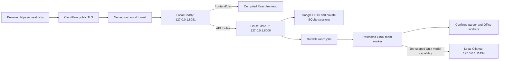

# investify.fyi from the local machine

27 October 2026. Hosting is active for authenticated private workflows, following
the measured acceptance below. Financial, material, model-quality and exact-file
investor release gates remain separate and incomplete.

## Current live checkpoint: authenticated private workflows public

**https://investify.fyi now serves the frontend, Google sign-in and authenticated
private workflow APIs.** The earlier sign-in-only proxy restriction and disabled
room worker described in historical checkpoints are superseded. The local preview is
`http://127.0.0.1:8080`.
Windows Caddy serves the compiled frontend and proxies to the Ubuntu 24.04 WSL
API on loopback 8000. Windows Ollama remains loopback-only; WSL mirrored
networking connects the services. `investify-room-worker.service` is enabled and
active as the separate durable worker. No collector or trainer is running.

Authenticated public HTTP acceptance passed **35 checks** using factory sessions
for the existing Google-verified identities; this did not perform new OAuth
callbacks. The checks cover the bounded two-user workflow/isolation slice recorded
in `/home/investify/runtime/public-http-isolation-20261026T192851Z-67184ee2dc/report.json`.
Anonymous public routing passed **10 checks**, loopback HTTP passed **47**, and
the integrated backend passed **513 tests** under the API service restrictions.
Frontend checks passed **15 tests**, build and lint. Existing users/sessions and
labelled synthetic acceptance fixtures were preserved.
A fresh real Chrome Google callback on the final frontend bundle then opened
My companies and completed logout. Its separate receipt is outside Git at
`hosting/network/final-browser-auth-smoke.json`.

Real isolated 9B extraction completed in **20.111 seconds**. A bounded durable
worker pass completed in **2.181 seconds**, recording `source_selection` with zero
model calls and zero network bytes observed through IP accounting. Financial processing correctly
remains blocked when source workbooks lack cached formula results. These are
execution/isolation observations, not financial, investor-material, model-quality
or training acceptance. Final investor release remains blocked by its mandatory
exact-file validation and qualified review gates.

Both enabled Linux units, `investify-api.service` and
`investify-room-worker.service`, run as user `investify`. The worker retains the
API's full service restrictions: `NoNewPrivileges`, `PrivateTmp`, strict system
protection, restricted kernel/control-group access and writes limited to the
private/runtime directories. Its configured environment loads before application
imports. The active
database is `/home/investify/private/app.db` (0600); uploads/artifacts are beneath
that private directory, outside `/home/investify/app`. All 24 original database
tables were checked during cutover. The Windows original and checked backup at
`runtime_backups/local-hosting/20261026T141544Z-f8d81a14/` remain history.
Do not start a second Windows API against that historical database.

The two current supervisors, from PowerShell at the repo root, are:

```powershell
powershell.exe -NoProfile -ExecutionPolicy RemoteSigned -File deployment/local/start_local_host.ps1
powershell.exe -NoProfile -ExecutionPolicy RemoteSigned -File deployment/local/start_outbound_host.ps1 -Mode private-workflows
```

Current-user Startup shortcuts are configured for both supervisors. The outbound
shortcut was backed up and verified with `-Mode private-workflows` for the current mode;
omitting `-Mode` still defaults to `sign-in-acceptance`. Startup configuration is
checked, but next-login execution and reboot recovery are untested. The local supervisor owns preview Caddy 8080 and a WSL
keepalive. The outbound supervisor independently owns Caddy 8081, cloudflared and
its own WSL keepalive; ten-second API health checks fail closed after three
consecutive failures. Both have duplicate-instance guards; inspect actual
processes before acting. The outbound supervisor is now active in explicit
`private-workflows` mode with `Caddyfile.tunnel`. Neither supervisor directly starts
the room worker; the enabled Linux unit owns it. No local public TCP 80/443 listener
is needed.
Linux code has a SHA-256 manifest under `/home/investify/app`; its venv is
`/home/investify/venv`. Credentials are in `/home/investify/private/server.env`
(0600); never print it. The protected Windows `.env` marks LOCAL_API_RUNTIME=wsl,
and configured Windows preview/API launches refuse accidental data forks.

Read-only inventory of the active runtime:

```powershell
wsl.exe --distribution Investify --user investify --exec /home/investify/venv/bin/python -B /home/investify/app/scripts/local_hosting.py check --env-file /home/investify/private/server.env --json
```

Exit 2 means mandatory investor/output release gates remain. Earlier focused Linux software result:
**263 passed**, plus a Windows-specific guard checked separately. **18 native
socket/storage checks** passed under the full service restrictions. The opt-in
`PRIVATE_MODEL_IPC=unix-ollama-v1` relay grants one job-specific Unix socket,
at most six requests/120 seconds, fixed loopback Ollama operations, no management
routes/credentials/redirects, and cancellation before first model output. The
bubblewrap network remains unshared. Directory literals fail closed on Linux
because recursive binds would disclose ungranted descendants. The later bounded
private HTTP acceptance is recorded above; complete financial/provenance and
investor-material qualification remain open.

The earlier 100-second `qwen3.5:9b` failure is preserved at
`/home/investify/runtime/model-canary-e29c44cb1899/`. Measured GPU placement now
improves this installed model on the actual **6 GB RTX 2060**. The opt-in trusted
profile `LOCAL_OLLAMA_HARDWARE_PROFILE=rtx2060-qwen35-9b-v1` is active: batch 128,
33 GPU layers through 2,048 context or 31 through 16,384; larger contexts fail
closed. It leaves model roles/defaults and the 120-second/six-call budget intact.
A real isolated LocalModel/Unix-socket streaming canary processed 5,786 prompt
tokens plus 30 output tokens in 16.88 seconds with normal stop/exact boundary
markers. A 14,438-token stress run completed but produced a wrong sum and
unfinished prose. These are latency measurements, not financial/semantic quality
acceptance. Models were unloaded after that earlier canary. Staged inference suite:
132 passed, one skipped. Receipts/failures are indexed in handoff section 82.

LibreOffice 24.2.7.2's default initial-page `/OpenAction` was the PDF blocker.
Explicit source-specific static-export options omit that action during generation
and retain accessibility tags; the existing validator is unchanged. Intro,
three-page pitch and memo editable/PDF pairs pass structural/text/page checks.
Original and fixed intro/memo rasters are pixel-identical. The five-page memo
keeps all 20 paragraphs within individual pages. Changed-input visible/hidden
XLSX formula canaries also pass. Staged PDF/Linux isolation tests: 22 passed;
native renderer/recalculation checks: four passed. Full delivery suite:
662 passed, eight skipped, four existing Apple Vision/macOS sandbox assumptions
failed. This does not qualify private Office/OCR, visual review, public KB or
exact-file investor release. Original failures remain retained.

Both fixes were staged with previous-manifest checks and original-file backups.
The API was restarted only after zero active jobs/leases and coordination with
isolated inference tests. Windows port 8080 subsequently returned API `ok` and
frontend HTTP 200. No database reset occurred. The worker was disabled at that
earlier checkpoint and has since been enabled after the acceptance above.

The earlier sign-in-only public route was verified using normal OS DNS, without
overrides. Its ten smoke requests passed: HTTPS frontend/assets 200, API health 200/exact
`ok`, auth config 200, anonymous auth/me 401, private API 503 and secret/upload/
model paths 404. HTTP returns 301 to HTTPS preserving the path; the certificate
verifies and CF-Ray is present. Receipt: private
`hosting/network/public-domain-smoke.json`. Cloudflare Universal certificate is
Active, Always Use HTTPS is enabled and minimum TLS is 1.2. Named tunnel
`f08301be-2c5b-4597-8888-f0e008da1a3a` has four outbound connections and a private
token file. Cloudflare nameservers are authoritative; the former parking A pair
was replaced by a proxied CNAME to that tunnel's `cfargotunnel.com` hostname.
MX/SPF/DKIM/Google verification were preserved against direct authoritative
answers. A local ISP resolver retaining the former Porkbun delegation was bridged
by setting the old zone's apex A records to Cloudflare addresses `104.21.31.42`
and `172.67.174.243`, TTL 600, preserving all mail records. Cloudflare remains
authoritative. No router login/forwarding is needed for this route; direct ingress
remains unverified and previous temporary IPv6 firewall rules remain removed.

**Cloudflare terminates public TLS; authenticated private uploads and workflow
APIs now route to the local backend.** The earlier 8081 acceptance listener allowed
only health/auth and returned 503 for other APIs; that mode is superseded by the
active `Caddyfile.tunnel` route. Two real Google accounts previously completed browser sign-in and logout:
two distinct sandbox owners, two memberships, zero foreign memberships and zero
reviewer qualifications. Those initial test sessions were revoked at that checkpoint.
Receipt: `/home/investify/runtime/public-oidc-acceptance.json`. This qualifies the
observed sign-in/provisioning/logout slice. The subsequent 35-check public test
used existing verified identities and preserved existing users/sessions.
The room worker is now enabled. Financial/compliance and exact-file investor
release gates remain open; ordinary private workflow access does not grant release.

User-requested Claude Code 2.1.310 was signature-checked, authenticated with Pro
and completed a sanitized generic review in 29.54 seconds, with tools/MCP/skills/
hooks disabled. No private company/gold/evaluation inputs were supplied. Receipt:
private outside-Git `hosting/claude-code/generic-review` storage.

## Current outbound architecture and ports

All application services remain on this machine. Cloudflare provides public TLS
and the outbound route; the local backend authorizes private workflow access.



| Listener | Exposure | Purpose |
| --- | --- | --- |
| Public TCP 80 / 443 | Cloudflare edge | HTTP redirects to HTTPS; Cloudflare terminates TLS |
| 127.0.0.1:8000 | Local only | FastAPI; never forward this router port |
| 127.0.0.1:11434 | Local only | Models called by the backend; no public model endpoint |
| 127.0.0.1:9200 | Local only, currently absent | Rights-reviewed public knowledge base |
| 127.0.0.1:2019 | Disabled in active tunnel template | Caddy administration remains off |
| 127.0.0.1:8080 | Local preview only | Anonymous UI/API routing check |
| 127.0.0.1:8081 | Local origin for named tunnel | Frontend and authenticated private APIs |
| 127.0.0.1:18082 | Local only | cloudflared metrics |
| 5173 | Development only | Vite; production serves the compiled build |

Only `frontend/dist` is a static web root. The repository, SQLite, uploads,
weights, failed evals and private artifacts must never be served as static files.
Private previews/downloads require authenticated room routes and tenant checks;
final investor downloads also require mandatory exact-file release gates. API errors
retain their status; missing JS assets return 404 rather than SPA HTML.

## Verified machine snapshot

- Historical pre-migration continuation: the loopback preview was running at `http://127.0.0.1:8080`,
  with the API on loopback 8000 and **no room worker**. Google Web credentials
  were configured and loaded; callback was unrun at that historical checkpoint.
  The current two-account sign-in/logout result is recorded above.
  It was not then registered for startup; the current supervisor is.
- Microsoft-signed WSL 3.0.3 is installed and VirtualMachinePlatform enabled.
  Its historical receipt required a restart. That restart and Ubuntu setup are
  complete, with the newer socket boundary above. Installation is not qualification.
- Windows 11 Home, Intel i7-8750H, approximately 23.8 GiB usable system RAM;
  RTX 2060 with 6 GiB VRAM. Synthetic single-request throughput is measured above;
  concurrent-user and production financial/model quality remain unqualified.
- Python venv 3.14.8 and Node 24.21.0. Required application imports are installed.
  Caddy 2.11.7 was downloaded from the official release and checked against its
  published SHA-512 checksum, under ignored `deployment/.secrets/caddy/`.
- Initial services: Ollama on loopback, no loaded models; API/frontend stopped.
  SQLite metadata showed zero running room jobs/leases and no signed-in users.
  These are observations, not permanent assumptions.
- LAN address observed: `192.168.1.14`; gateway: `192.168.1.254`.
  Public IPv4 observed: `101.0.63.110`; it may change.
- Porkbun authoritative DNS was confirmed. Apex A records initially resolved to
  `207.207.210.107` and `207.207.210.229`; no AAAA answer was observed.
  The authenticated domain drawer identifies the apex parking record as an
  **ALIAS to `pixie.porkbun.com`**, rather than manually configured A records.
  These were initial DNS observations; public DNS/TLS now pass as recorded above.
  Direct router access, inbound ISP access and CGNAT remain unverified.

## Blocking code/runtime findings

| Area | Concrete finding | Consequence |
| --- | --- | --- |
| Windows model routing | `os.sysconf` is absent and was not caught | Fixed: conservative 16 GiB fallback, covered by a regression test |
| Private file storage | `delivery/storage.py` requires `O_DIRECTORY`, `O_NOFOLLOW` and directory-relative file descriptors | Native Windows file ingestion/artifact storage fails; do not replace these protections with ordinary path opens |
| Private execution | `delivery/isolation.py` implements Seatbelt and bubblewrap, with no native Windows backend | Active private processing uses confined Linux WSL workers; native Windows execution still fails closed |
| Linux runtime | Explicit Unix model IPC and parser/inspection boundaries are natively tested; directory literals fail closed | Bounded private HTTP acceptance passed; full financial/provenance qualification remains open; no host network sharing |
| Office/OCR | Static PDF checks pass; historical Apple Vision OCR now has a confined Linux Tesseract reference-transcription path | Native OCR diagnostics are retained below; full private document production and visual/financial acceptance remain unqualified |
| Login | Two real Google sign-ins provisioned distinct sandboxes; later public factory-session checks exercised existing verified identities | Bounded two-user HTTP/isolation slice passed; new roles, broader workloads and final investor release need their own evidence |
| Public KB | Local registry/archive and Elasticsearch absent | Discovery/room KB service cannot be claimed available |
| Background work | Discovery retains bounded BackgroundTasks; automatic preparation preserves identity and uses durable room jobs | One API process and one restricted durable worker are active; concurrent load and multiple Uvicorn workers remain unqualified |
| Training | Existing paths include MLX, POSIX `resource`, CUDA stack and historical repo-local private-output assumptions | Imported files do not establish a Windows training runtime or authorize bypassing storage/review policy |

The focused Windows run passed 67 checks and failed two existing room tests,
at the POSIX storage operations above. The final focused hosting/import/auth/routing selection passed 63 checks. Actual loopback HTTP checks also passed, including callback error-log redaction; both test services stopped cleanly.
Do not report that combined run as green or skip those failures to claim release.

## Safe local routing preview

These are historical Windows commands. Configured Windows launches now refuse
after migration; use the current Linux supervisor/inventory above.

From the repository root in PowerShell:

```powershell
.\.venv\Scripts\python.exe -B scripts/local_hosting.py check --json
.\.venv\Scripts\python.exe -B scripts/local_hosting.py preview
```

The check is read-only and uses model metadata GET requests only. Exit 2 means
unmet or unrun full release prerequisites, even when `routing_ready` is true.
Use `--offline` to omit the loopback model inventory.

The explicit preview verifies Caddy config, checks active room jobs/leases and
ports, creates and checks a SQLite online backup, then runs the API with
`--without-worker` and a Caddy listener bound only to 127.0.0.1:8080. It disables
development password login and uses the production application origin. It is an
anonymous routing check: HTTP localhost is not the production sign-in origin.
Stop with Ctrl+C; `--seconds 30` provides a bounded smoke run. It never changes
DNS/firewall rules or starts inference, collectors, room jobs or training.
An existing listener is never killed automatically. The current-user Startup
shortcut now launches the Linux supervisor; the old preview has no boot task.

## Configuration and Google sign-in

The registered Web client, `Investify local host`, is in Google Cloud project
`local-turbine-511521-n0` with the origin and callback below. No compute or billing
resource was created. Server credentials are already in the ACL-restricted,
ignored `deployment/.env`; its original downloaded JSON is in the restricted
private hosting directory outside Git. Do not recreate or expose these secrets.
Two real Google browser sign-ins/logout passed as recorded above. Broader consent
audience and complete private workflow acceptance are separate from that slice.

For a new installation only, copy `deployment/local/env.example` to ignored
`deployment/.env`, then edit it locally. Do not overwrite this machine's existing
credential-bearing file. The file uses literal KEY=VALUE values: no shell evaluation,
interpolation or inline comment syntax. Keep secrets out of VITE_* variables,
Git, this chat, screenshots and routine logs.

The backend now accepts an explicit server-side file:

```powershell
.\.venv\Scripts\python.exe -B scripts/serve_local.py --env-file deployment/.env --without-worker
```

This is a backend command, not permission to publish. Its host stays loopback and
access logging remains disabled. Existing defaults and `--local-dev` behavior
remain available when an environment file is not supplied. Worker processes
inherit the same explicit backend environment when intentionally enabled.

The Google Auth Platform client is of type **Web application**:
authorized JavaScript origin `https://investify.fyi`, exact redirect URI
`https://investify.fyi/api/auth/callback`. Configure the consent audience and
test users as appropriate; store client ID/secret only on the backend.
Keep `APP_ENV=production`, `ALLOW_LOOPBACK_HTTP=0` and
`LOCAL_DEV_PASSWORD_LOGIN=0`. First verified login provisions an isolated sandbox;
it never grants old default-tenant data or a compliance-reviewer role.
The bounded two-user private HTTP checks are recorded above. Repeat acceptance
for changed authentication/isolation behavior and broader workloads. Neither
sign-in nor these checks approves financial statements or final investor files.

## Historical direct-ingress alternative: Porkbun and router

The authenticated Cloudflare nameserver change described above supersedes the
old recommendation to keep Porkbun nameservers. This sequence is retained only
as an alternative if direct inbound routing is independently established; do not
apply its DNS instructions over the current outbound-route work.

1. Open the router administration page associated with `192.168.1.254` and read
   **Internet/WAN IPv4**. Compare it with a freshly observed public IPv4. An RFC1918
   or 100.64.0.0/10 WAN address, or a mismatch, needs investigation for double NAT
   or CGNAT. No router settings have been changed.
2. Reserve this machine's LAN address in DHCP. Confirm the ISP permits inbound
   TCP 80/443 and the WAN address is reachable from another network.
   If CGNAT blocks inbound access, obtain inbound-capable connectivity or qualify
   an operator-controlled relay/private transport. The current selected route
   already uses Cloudflare TLS termination for authenticated private uploads.
3. After the runtime/authentication gates pass, add router TCP mappings:
   WAN 80 -> reserved LAN IP:80; WAN 443 -> reserved LAN IP:443. Allow only these
   public web ports in Windows Firewall for the intended Caddy executable.
4. In Porkbun Domain Management > investify.fyi > DNS Records, replace only the
   apex parking ALIAS (`pixie.porkbun.com`) with an A record for the confirmed
   current public IPv4 once inbound hosting works. Preserve MX,
   TXT and unrelated records. Do not add AAAA without verified IPv6 routing.
   For this historical direct-ingress alternative, Porkbun nameservers would have
   been sufficient; the current continuation has selected Cloudflare instead.
5. Use `deployment/local/Caddyfile` from the repo root, with an absolute
   `INVESTIFY_WEB_ROOT` pointing to the build. Caddy needs persistent writable
   certificate storage. The template is prepared but has not been published.
6. Test DNS, certificate chain, HTTP->HTTPS redirect, UI routes, API authentication,
   uploads and private files from a cellular/other external connection.
   An internal browser alone cannot prove NAT reachability or hairpin support.

Caddy supports automatic certificate renewal when DNS and inbound routing are
correct. A changing public IP needs a separately configured, credential-protected
DNS update mechanism. Boot supervision, power/sleep behavior, consistent SQLite
backups and external recovery checks remain operational acceptance work.

## Restart checkpoint

The following is the historical installation receipt. The required restart is
complete; no additional Windows restart is currently needed.

WSL's completed installation receipt is
`C:/Users/gaura/AInvestifyPrivate/hosting/wsl/installation.json`.
It records `installed=true`, `reboot_required=true`, `reboot_initiated=false`
and `private_worker_qualified=false`. The pinned official MSI was verified by
SHA-256 and Microsoft's Authenticode signature. Do not rerun the installer.

Ubuntu and the restricted model IPC/storage foundation have since been installed
and checked above. Keep private data outside Git. Resume the current supervisor,
not the historical Windows preview.

The router at `http://192.168.1.254/` is a GPON Home Gateway with a login form.
A single sign-in using supplied credentials did not establish an authenticated
session; the current page requests the default password. No credentials were
guessed, no forwarding was changed and no router password is saved in this repo.
Automatic read-only IGD discovery found no advertised gateway service. WAN IPv4
and CGNAT therefore remain unknown. Use the operator/ISP-provided router login;
do not retry a rejected password automatically.

## Imported models, evaluations and training

The supplied tar originals remain in Downloads. Extracted copies and detailed
hash/registration manifests live outside Git in the restricted local directory
`C:/Users/gaura/AInvestifyPrivate/imports/2026-10-26/`.

- `ollama_models/`: verified blobs and eight imported model manifests. Registration
  added seven tags and 23 blobs, reused one tag and five blobs, with zero conflicts.
  It adds only missing files to the user's existing Ollama store; byte-identical
  files are reused, conflicting tags are preserved and reported.
- `private_evals_and_weights/`: complete evaluation/history/candidate archive.
  Original paths and bytes are retained; contents are never executed or copied
  over the repository's regression tests.
- Historical initial memo-subset inventory: eight JSONL files, 532 rows; 156 explicitly valid/test,
  zero explicit train rows and zero rows carrying two-reviewer adjudication.
  These are inventory counts, not eligibility or correctness judgments.
- Eval/gold/private acceptance inputs remain held out. Candidate saved responses
  need independent source/target review and company/evidence-family separation
  before a training exporter may accept them. User source permission does not
  certify the correctness of a failed historical model response.
- GGUF/Ollama inference blobs are not a Transformers training checkpoint.
  Any recovered MLX checkpoint is platform-specific until compatibility is
  checked; do not download a replacement automatically.
- The initial gold validator rejected all 532 mixed-schema rows; the recursive
  classification below supersedes that result and separates logs from candidates. Eleven
  safetensors files include four adapter files and quantized Qwen2/Qwen3.5
  checkpoint configurations. They are retained without activation or qualification.
- At import time no training, generation, model download, hosted private processing
  or paid compute was run; the later synthetic inference canary is recorded above.
  A training run still needs an eligible reviewed train/valid/test
  corpus, a compatible pinned base, a qualified private runtime and a measured
  memory/time budget. Private trajectories/adapters must stay outside Git.

The later recursive intake supersedes the original inventory counts above:
**74 JSONL files / 1,552 rows** contain 156 memo candidates, 376 exclusions,
152 scorer keys, 152 synthetic fixtures, 470 trajectories, 180 protocol events,
65 unqualified chat/text rows and one reward record. There are 494 duplicate rows.
All 156 memo candidates pass runtime/source/schema checks but are explicitly
test-only and pending adjudication. **Zero rows are eligible for weight updates.**
Keep holdouts and scorer keys held out; tool traces are not approved answers.
Outside-Git private-storage/audit/training policy fixes passed 57 staged native
tests. Checked 14-file staging receipt:
`/home/investify/runtime/code-stage-training-8c5f8bb3a5b3`. No training, corpus
export, adapter activation or production model-role change occurred. Those
software checks do not establish compatible checkpoint/runtime capacity,
reviewed gold or source rights.

## 27 October reference, OCR and model-capacity repair checkpoint

The seven newly supplied references were copied byte-exact into approved private
storage; their import receipt is
`/home/investify/private/reference_samples/2026-10-27-5fd82b6dda/import-manifest.json`.
Original files remain unchanged. Private structural inspections and their raw
results are retained beneath that directory. Reference figures, model answers
and private evaluations were not supplied to Claude or another hosted model.
The coordinator's Claude Code work is restricted to sanitized generic code/task
review, separate from local processing of these references.

The Linux OCR qualification recovered all **37 pages in 22.686 seconds** under
the corrected pinned profile:
`/home/investify/private/ocr_qualification/2026-10-27-b5d4d05441`.
The earlier 19.443-second run is preserved as historical raw evidence and is not
adopted under the corrected pins. The corrected path binds the original bytes,
raw PNG/TSV, page geometry, projection source and recorded native runtime. It
checks PNG IHDR geometry/CRC, TSV hierarchy, page coverage and literal replay;
eight-page batches run in fresh network-denied processes with bounded files,
memory and time. **21 native OCR/manifest checks passed**, including forbidden
file/environment/model-network capabilities and rebased geometry/code tampering.
OCR text remains `local_ocr_proposed_unreviewed`; financial validation is
`not_established`. This does not establish numerical accuracy, table alignment,
financial reconciliation or final investor-file quality.

The actual supplied Toffee XLSX was audited in an isolated private process in
**0.378 seconds**, before any Office conversion. It has **14 worksheets, five
hidden, and 3,008 formula cells**. Inspection found 104 stored cell errors, one
missing formula cache, 22 broken formula references, two broken defined names
and 23 unsupported/unknown references. The unchanged converter gate returned
`blocked_before_office` for unknown references. No actual recalculation, model
call or live database write occurred, and the original source hash is unchanged.
Metadata evidence is
`/home/investify/private/workbook_qualification/2026-10-27-7db511acce/report.json`.
Raw formula reports remain private. These findings do not establish a valid
historical model or forecast, or prove that any formulas were lost.

Training-source permission for the new references is recorded separately from
their historical acceptance reservations. Five of seven originals match archived
bytes exactly; all seven match original-source declarations in three existing
acceptance families. Two declaration-only versions remain unresolved. The private
immutable family ledger and seven pending review requests are at
`/home/investify/private/training_preparation/2026-10-27-seven-v1/`.
These are source/version/evaluation review packets, not approved training targets.
No independent new training family was established, and no held-out document or
layout derivative was moved into training. Unmatched future references remain
unassigned and unadjudicated rather than automatically becoming test cases.
Training preparation/runtime changes passed **62 focused software tests**.

The actual GPU remains an RTX 2060 with **6 GiB VRAM**. Windows has approximately
24 GiB system RAM, but the measured WSL training runtime sees only **7.76 GiB**.
No 32B model is installed. A two-call synthetic feasibility pass took 113.2
seconds: the installed 14B model timed out at its 40.028-second cold allocation;
the installed 27.3B alias with thinking enabled timed out at 73.005 seconds with
no completed answer. This does not prove the 14B cannot finish a longer allocation,
and neither result qualifies a replacement production route. Raw failures are at
`/home/investify/private/model_capacity/20261026T200106Z/`.

Header-only inspection of the recovered packed MLX checkpoints estimates 0.988 GB
and 18.819 GB of expanded BF16 weights, excluding gradients, optimizer state and
activations. Blind expansion of the larger checkpoint would exceed measured WSL
RAM. The CUDA training packages are absent and no compatible converted base has
been qualified. The prepared trainer selects FP16 when native BF16 is unsupported,
rejects unsupported explicit BF16 and permits only existing local checkpoints;
automatic model downloads remain disabled. Runtime evidence is
`/home/investify/private/training_preparation/2026-10-27-runtime-v2/report.json`.
No weight update or production model change occurred. Real training requires
independent non-held-out source families, validated/adjudicated local targets,
a qualified offline checkpoint conversion and a measured training runtime.

One IM section completed its author step, but the subsequent same-model,
non-independent review returned `REVISE` for entity/metric distinctions and
insufficient depth. The hardened material tests passed 111 checks with one
explicit Office canary skipped, but review/correction failures remain; this is
not an accepted memorandum or complete material package. A later full-source 14B
review timed out after 105.113 seconds without an answer, despite 96% GPU use and
approximately 5.274 GB VRAM. An optional versioned 8B reviewer branch remains
outside the deployed discovery snapshot. Its 140 native checks passed, but its
single full-source probe timed out at the shared 105.01-second budget. The bounded
reasoning phase completed; the final answer request produced no terminal response.
No valid review or patch was accepted; the model was unloaded. Both models were
tested against the same complete four-page source and exact IM draft, without
shrinking the source or relaxing the quality gates.

Discovery repair is now deployed and verified through the actual authenticated
public UI. Retrying the original unchanged brief created
[source_run_ead46f340149](https://investify.fyi/leads?run=source_run_ead46f340149)
with three source-bound preliminary matches: CRED, Lentra and Paytm. Their exact
product evidence, own-company geography, publication metadata and response
bindings passed audit. Article vintages are 2023, 2022 and 2021 respectively;
current operating status remains unverified and financial assessment was not
performed. The requested target of 20 remains unmet: five model calls completed
and a sixth additional-source request was cancelled at the 120-second bound
(120.033 seconds measured usage). The run is explicitly partial, and the original
failed run remains unchanged. Evidence:
`/home/investify/runtime/public-discovery-evidence-audit-20261026T224357Z-9b03d28e/report.json`.

The final prospective repair integration passed 361 tests with one explicit Office
canary skipped. After a 24-table online SQLite backup and zero-active-job check,
31 exact tested files were installed; both API and room worker are active. Stage
receipt: `/home/investify/runtime/repair-code-stage-20261026T223911Z-6cfd4797/receipt.json`.
The pre-documentation manifest is
`469468772c64ec5c468883799d495bf2622a384df2649ee3704f9d191610b28b`.
Build/lint passed and the public frontend uses `index-CkV2puP3.js`, displaying
failure details, fresh retry, source dates and diligence gaps. Eight fresh public
anonymous checks passed. No production training or model-role promotion occurred.
Reference OCR and these software/public checks do not establish the required
intro deck, pitch deck, investment memorandum and matching PDFs, or final
financial/model-quality acceptance. Exact-file checks and human release gates
remain in force. See [handoff section 84](../SESSION_HANDOFF.md#84-27-october-public-discovery-repair-and-private-reference-qualification)
for current qualifications and private evidence paths.

## Source documentation

- [Caddy SPA/API routing](https://caddyserver.com/docs/caddyfile/patterns)
- [Caddy automatic HTTPS requirements](https://caddyserver.com/docs/automatic-https)
- [Caddy logging filters](https://caddyserver.com/docs/caddyfile/directives/log#filter)
- [Porkbun A-record configuration](https://kb.porkbun.com/article/54-how-to-use-a-records-to-point-your-domain-at-a-web-host)
- [Google web OAuth configuration](https://developers.google.com/identity/protocols/oauth2/web-server)
- [Ollama on Windows](https://docs.ollama.com/windows)

The controlling contracts remain AGENTS.md, LOCAL_TO_CLOUD_RELEASE_PLAN.md and
the financial/public KB plans. Infrastructure routing does not waive private
isolation, local-model authorship, evidence, compliance or exact-file release gates.
